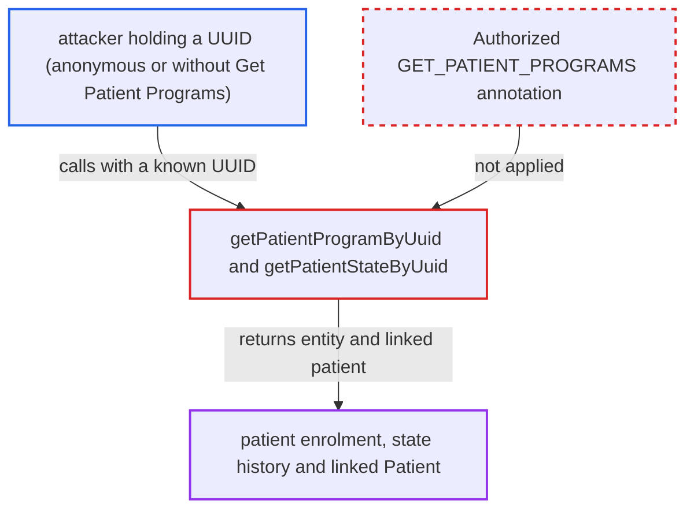

# ProgramWorkflowService UUID lookups of PatientProgram and PatientState lack @Authorized

| Field | Value |
|---|---|
| ID | `find_01VWT5YM7fpBjBcKRUoGsuid` |
| Severity | **Low** |
| Status | open |
| CWE | CWE-862 — Missing authorization |
| Created | 2026-10-21T23:00:40.314207Z |
| Claude Security | https://claude.ai/security/findings/find_01VWT5YM7fpBjBcKRUoGsuid |

## Description

A caller who already knows a patient-program UUID or patient-state UUID can read that patient's programme enrolment, its state history and the linked patient record. This includes an anonymous caller or a logged-in user without `Get Patient Programs`. The report says the server is reachable only from the internal network. The cause is that `getPatientProgramByUuid` and `getPatientStateByUuid` in `ProgramWorkflowService` have no `@Authorized` annotation, so no check runs.

1. **the attacker** obtains a patient-program or patient-state UUID. The UUID can come from REST URLs, logs, earlier access, or the `createdPrograms` UUIDs returned by the unannotated `PersonService.getAllPersonMergeLogs`.
2. **the attacker** calls `getPatientProgramByUuid` or `getPatientStateByUuid` on the service. Neither interface method carries `@Authorized`, unlike `getPatientProgram(Integer)` and the `getPatientPrograms` overloads, which require `Get Patient Programs`. ([`api/src/main/java/org/openmrs/api/ProgramWorkflowService.java:478`](https://github.com/cx-benchmark/openmrs-core/blob/e6a1b3374ef040e8821dbe4bacc1bdcb50fa4d29/api/src/main/java/org/openmrs/api/ProgramWorkflowService.java#L478))
3. **the advice `AuthorizationAdvice`** lets the call through without any check. It reads annotations only from the interface method, and with no annotation it requires neither a privilege nor authentication. ([`api/src/main/java/org/openmrs/aop/AuthorizationAdvice.java:59-99`](https://github.com/cx-benchmark/openmrs-core/blob/e6a1b3374ef040e8821dbe4bacc1bdcb50fa4d29/api/src/main/java/org/openmrs/aop/AuthorizationAdvice.java#L59-L99))
4. **the service `ProgramWorkflowServiceImpl`** returns the entity straight from the data layer. It returns `dao.getPatientProgramByUuid(uuid)` without calling `Context.requirePrivilege`. ([`api/src/main/java/org/openmrs/api/impl/ProgramWorkflowServiceImpl.java:543-547`](https://github.com/cx-benchmark/openmrs-core/blob/e6a1b3374ef040e8821dbe4bacc1bdcb50fa4d29/api/src/main/java/org/openmrs/api/impl/ProgramWorkflowServiceImpl.java#L543-L547))
5. **the attacker** reads the enrolment and follows its links to the patient. `getPatient()` and `PatientState.getPatientProgram()` are Hibernate associations that do not pass through the service advice, so no privilege such as `Get Patients` is checked.

## Assessment

The attacker is an anonymous caller or an authenticated user without `Get Patient Programs`, because no annotation means no check. They reach the service through a module or REST path. They need a patient-program or patient-state UUID, since random UUIDs cannot be enumerated. UUIDs are identifiers, not secrets. They appear in REST URLs and logs, and the unannotated `PersonService.getAllPersonMergeLogs` returns `PersonMergeLogData.createdPrograms` UUIDs. No victim action is needed. The threat model says the server is reachable only from the internal network.

Impact: For each UUID the attacker holds, they can read that patient's programme enrolment, which can reveal diagnoses such as HIV or TB. They also get its state history and the linked patient demographics. The methods cannot list records or write to them, so the exposure is limited to records whose UUID is known.

## Recommendation

The by-UUID read methods `getPatientProgramByUuid` and `getPatientStateByUuid` lack the `@Authorized(GET_PATIENT_PROGRAMS)` annotation that their by-id and list counterparts carry.

Fix criteria: `getPatientProgramByUuid` and `getPatientStateByUuid` require `Get Patient Programs`. A caller without that privilege receives `APIAuthenticationException` and no entity.

## Evidence

**https://github.com/cx-benchmark/openmrs-core**

- [`api/src/main/java/org/openmrs/api/ProgramWorkflowService.java:478`](https://github.com/cx-benchmark/openmrs-core/blob/e6a1b3374ef040e8821dbe4bacc1bdcb50fa4d29/api/src/main/java/org/openmrs/api/ProgramWorkflowService.java#L478)
- [`api/src/main/java/org/openmrs/api/ProgramWorkflowService.java:224`](https://github.com/cx-benchmark/openmrs-core/blob/e6a1b3374ef040e8821dbe4bacc1bdcb50fa4d29/api/src/main/java/org/openmrs/api/ProgramWorkflowService.java#L224)
- [`api/src/main/java/org/openmrs/api/impl/ProgramWorkflowServiceImpl.java:543-547`](https://github.com/cx-benchmark/openmrs-core/blob/e6a1b3374ef040e8821dbe4bacc1bdcb50fa4d29/api/src/main/java/org/openmrs/api/impl/ProgramWorkflowServiceImpl.java#L543-L547)
- [`api/src/main/java/org/openmrs/api/impl/ProgramWorkflowServiceImpl.java:576-580`](https://github.com/cx-benchmark/openmrs-core/blob/e6a1b3374ef040e8821dbe4bacc1bdcb50fa4d29/api/src/main/java/org/openmrs/api/impl/ProgramWorkflowServiceImpl.java#L576-L580)
- [`api/src/main/java/org/openmrs/aop/AuthorizationAdvice.java:59-99`](https://github.com/cx-benchmark/openmrs-core/blob/e6a1b3374ef040e8821dbe4bacc1bdcb50fa4d29/api/src/main/java/org/openmrs/aop/AuthorizationAdvice.java#L59-L99)
- [`api/src/main/java/org/openmrs/api/PatientService.java:106-107`](https://github.com/cx-benchmark/openmrs-core/blob/e6a1b3374ef040e8821dbe4bacc1bdcb50fa4d29/api/src/main/java/org/openmrs/api/PatientService.java#L106-L107)

