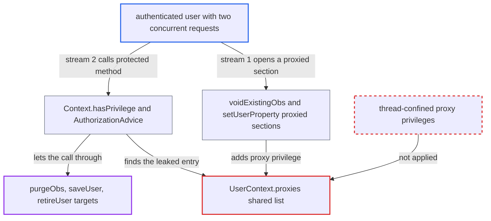

# Session-scoped proxy privileges leak to the same user's concurrent requests

| Field | Value |
|---|---|
| ID | `find_01Fgytph9X6DC9uwkG3mEyqL` |
| Severity | **Low** |
| Status | open |
| CWE | CWE-362 — Race condition |
| Created | 2026-10-21T22:57:51.065767Z |
| Claude Security | https://claude.ai/security/findings/find_01Fgytph9X6DC9uwkG3mEyqL |

## Description

A logged-in user can briefly gain privileges they were not given. This lets an `Edit Obs` user permanently purge patient observations, and lets a user edit, retire or unretire accounts whose privileges they already hold. The attacker needs two concurrent requests on one session and must win a race. The cause is that `UserContext.proxies`, a shared list on the session-scoped `UserContext`, holds temporary privilege elevations that every request of the session honours.

1. **authenticated attacker** sends two concurrent request streams on one session cookie. `OpenmrsFilter` binds the single `UserContext` stored in the `HttpSession` to the thread of every request of that session, so both streams share one `proxies` list. ([`web/src/main/java/org/openmrs/web/filter/OpenmrsFilter.java:73-107`](https://github.com/cx-benchmark/openmrs-core/blob/e6a1b3374ef040e8821dbe4bacc1bdcb50fa4d29/web/src/main/java/org/openmrs/web/filter/OpenmrsFilter.java#L73-L107))
2. **stream 1** repeatedly calls a low-privilege operation that opens a proxied section. For example, `saveObs` on an edited existing obs (needs `Edit Obs`) reaches `voidExistingObs`, which proxies `Delete Obs`. Setting a property on the attacker's own account runs `setUserProperty`, which proxies `Edit Users`. ([`api/src/main/java/org/openmrs/api/impl/ObsServiceImpl.java:124-145`](https://github.com/cx-benchmark/openmrs-core/blob/e6a1b3374ef040e8821dbe4bacc1bdcb50fa4d29/api/src/main/java/org/openmrs/api/impl/ObsServiceImpl.java#L124-L145))
3. **`UserContext.addProxyPrivilege`** adds the elevated privilege to the shared `proxies` list. The list is a plain `ArrayList` mutated without synchronisation, and nothing records which request or thread added the entry. ([`api/src/main/java/org/openmrs/api/context/UserContext.java:239-253`](https://github.com/cx-benchmark/openmrs-core/blob/e6a1b3374ef040e8821dbe4bacc1bdcb50fa4d29/api/src/main/java/org/openmrs/api/context/UserContext.java#L239-L253))
4. **stream 2** calls a protected method such as `purgeObs`, or `saveUser`/`retireUser` on a peer, while the window is open. `AuthorizationAdvice` and `requirePrivilege` ask `Context.hasPrivilege`, which delegates to the shared `UserContext`. ([`api/src/main/java/org/openmrs/aop/AuthorizationAdvice.java:73-84`](https://github.com/cx-benchmark/openmrs-core/blob/e6a1b3374ef040e8821dbe4bacc1bdcb50fa4d29/api/src/main/java/org/openmrs/aop/AuthorizationAdvice.java#L73-L84))
5. **`UserContext.hasPrivilege`** grants the privilege because it is found in `proxies`. The check ignores which request added the entry, so stream 2's check passes. ([`api/src/main/java/org/openmrs/api/context/UserContext.java:336-344`](https://github.com/cx-benchmark/openmrs-core/blob/e6a1b3374ef040e8821dbe4bacc1bdcb50fa4d29/api/src/main/java/org/openmrs/api/context/UserContext.java#L336-L344))
6. **stream 2** completes the operation without holding the privilege. `purgeObs` is gated only by `@Authorized(DELETE_OBS)`, which the leaked proxy satisfies. ([`api/src/main/java/org/openmrs/api/ObsService.java:164-183`](https://github.com/cx-benchmark/openmrs-core/blob/e6a1b3374ef040e8821dbe4bacc1bdcb50fa4d29/api/src/main/java/org/openmrs/api/ObsService.java#L164-L183))

## Assessment

The attacker is an authenticated user who can reach, from an internal network, any endpoint that maps onto core services (for example a module under `/ws/*`). The report says the system is not reachable from the internet. The attacker needs only low privileges such as `Edit Obs`, or any account for the `setUserProperty` route. Core does not serialise requests per session, and `synchronizeOnSession` is not set anywhere. One stream repeatedly opens a proxied section, and the other repeatedly calls the protected method. The race must be won, but failed attempts are harmless and can be retried. `PatientDataVoidHandler.java:63` also proxies `Edit Cohorts`, which opens the same kind of window.

Impact: An `Edit Obs` user can permanently purge any patient observation, which is irreversible, whereas voiding is already allowed to them. A user can also edit, retire or unretire accounts whose privileges they already hold, such as changing a colleague's email or username, and can modify cohorts. `checkPrivileges(User)` still stops them from reaching superuser, no new read access is gained, and the corrupted list affects only the attacker's own session.

## Recommendation

Proxy privileges are stored in a mutable list on the session-scoped `UserContext`. An elevation meant for one internal call is therefore honoured by `hasPrivilege` for every concurrent request on the same HTTP session.

Fix criteria: Proxy privileges are visible only to the thread or call that added them, for example through a thread-confined structure that `hasPrivilege` consults. They are also safe under concurrent add and remove. To verify, hold one request inside a proxied section such as `voidExistingObs` or `setUserProperty`. A concurrent request on the same session that calls `purgeObs` or `saveUser(peer)` without the privilege must be rejected.

## Evidence

**https://github.com/cx-benchmark/openmrs-core**

- [`api/src/main/java/org/openmrs/api/context/UserContext.java:57-60`](https://github.com/cx-benchmark/openmrs-core/blob/e6a1b3374ef040e8821dbe4bacc1bdcb50fa4d29/api/src/main/java/org/openmrs/api/context/UserContext.java#L57-L60)
- [`api/src/main/java/org/openmrs/api/context/UserContext.java:239-253`](https://github.com/cx-benchmark/openmrs-core/blob/e6a1b3374ef040e8821dbe4bacc1bdcb50fa4d29/api/src/main/java/org/openmrs/api/context/UserContext.java#L239-L253)
- [`api/src/main/java/org/openmrs/api/context/UserContext.java:336-344`](https://github.com/cx-benchmark/openmrs-core/blob/e6a1b3374ef040e8821dbe4bacc1bdcb50fa4d29/api/src/main/java/org/openmrs/api/context/UserContext.java#L336-L344)
- [`web/src/main/java/org/openmrs/web/filter/OpenmrsFilter.java:73-107`](https://github.com/cx-benchmark/openmrs-core/blob/e6a1b3374ef040e8821dbe4bacc1bdcb50fa4d29/web/src/main/java/org/openmrs/web/filter/OpenmrsFilter.java#L73-L107)
- [`api/src/main/java/org/openmrs/api/context/Context.java:730-737`](https://github.com/cx-benchmark/openmrs-core/blob/e6a1b3374ef040e8821dbe4bacc1bdcb50fa4d29/api/src/main/java/org/openmrs/api/context/Context.java#L730-L737)
- [`api/src/main/java/org/openmrs/aop/AuthorizationAdvice.java:73-84`](https://github.com/cx-benchmark/openmrs-core/blob/e6a1b3374ef040e8821dbe4bacc1bdcb50fa4d29/api/src/main/java/org/openmrs/aop/AuthorizationAdvice.java#L73-L84)
- [`api/src/main/java/org/openmrs/api/impl/ObsServiceImpl.java:124-145`](https://github.com/cx-benchmark/openmrs-core/blob/e6a1b3374ef040e8821dbe4bacc1bdcb50fa4d29/api/src/main/java/org/openmrs/api/impl/ObsServiceImpl.java#L124-L145)
- [`api/src/main/java/org/openmrs/api/ObsService.java:164-183`](https://github.com/cx-benchmark/openmrs-core/blob/e6a1b3374ef040e8821dbe4bacc1bdcb50fa4d29/api/src/main/java/org/openmrs/api/ObsService.java#L164-L183)
- [`api/src/main/java/org/openmrs/api/impl/UserServiceImpl.java:410-425`](https://github.com/cx-benchmark/openmrs-core/blob/e6a1b3374ef040e8821dbe4bacc1bdcb50fa4d29/api/src/main/java/org/openmrs/api/impl/UserServiceImpl.java#L410-L425)
- [`api/src/main/java/org/openmrs/api/impl/UserServiceImpl.java:161-174`](https://github.com/cx-benchmark/openmrs-core/blob/e6a1b3374ef040e8821dbe4bacc1bdcb50fa4d29/api/src/main/java/org/openmrs/api/impl/UserServiceImpl.java#L161-L174)

