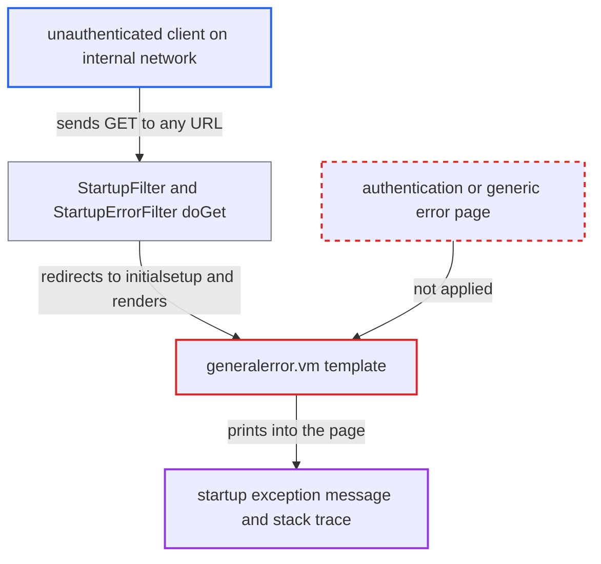

# Startup error page discloses exception messages and stack traces to unauthenticated clients

| Field | Value |
|---|---|
| ID | `find_0136E4FzrCxjzk3CPHtUz4Vf` |
| Severity | **Low** |
| Status | open |
| CWE | CWE-209 — Information exposure through error message |
| Created | 2026-10-21T22:56:48.564449Z |
| Claude Security | https://claude.ai/security/findings/find_0136E4FzrCxjzk3CPHtUz4Vf |

## Description

An unauthenticated client on the internal network can read the exception message and full stack trace of a failed OpenMRS startup. This reveals file paths, module and jar versions, Spring and Liquibase internals and sometimes lock-holder host details. It works only while the instance is in the failed-startup state. The cause is the startup error page, `generalerror.vm`, which prints the raw exception with no check.

1. **the startup listener `Listener.contextInitialized`** catches the startup exception and stores it in the static `Listener.errorAtStartup`. The value is never cleared, so the error state lasts until the webapp restarts. ([`web/src/main/java/org/openmrs/web/Listener.java:236-257`](https://github.com/cx-benchmark/openmrs-core/blob/e6a1b3374ef040e8821dbe4bacc1bdcb50fa4d29/web/src/main/java/org/openmrs/web/Listener.java#L236-L257))
2. **the wrapper in `WebDaemon.startOpenmrs`** rethrows startup failures as a `ModuleException` with the original cause. The wrapper repeats the cause's message, so module, Hibernate and Spring details end up in the stored error. ([`web/src/main/java/org/openmrs/web/WebDaemon.java:67-70`](https://github.com/cx-benchmark/openmrs-core/blob/e6a1b3374ef040e8821dbe4bacc1bdcb50fa4d29/web/src/main/java/org/openmrs/web/WebDaemon.java#L67-L70))
3. **the filter `StartupErrorFilter`** handles every request once startup has failed. `skipFilter` returns false for all requests while `Listener.errorOccurredAtStartup()` is true, and the filter is the first one on `/*`. ([`web/src/main/java/org/openmrs/web/filter/startuperror/StartupErrorFilter.java:118-121`](https://github.com/cx-benchmark/openmrs-core/blob/e6a1b3374ef040e8821dbe4bacc1bdcb50fa4d29/web/src/main/java/org/openmrs/web/filter/startuperror/StartupErrorFilter.java#L118-L121))
4. **an unauthenticated client** sends a GET request to any path such as `/openmrs/<anything>`. `StartupFilter.doFilter` redirects the request to `/openmrs/initialsetup` and passes the GET to `doGet`, with no login or other check. ([`web/src/main/java/org/openmrs/web/filter/StartupFilter.java:150-157`](https://github.com/cx-benchmark/openmrs-core/blob/e6a1b3374ef040e8821dbe4bacc1bdcb50fa4d29/web/src/main/java/org/openmrs/web/filter/StartupFilter.java#L150-L157))
5. **the model `StartupErrorFilterModel`** hands the raw `Throwable` and `ExceptionUtils.getStackTrace(t)` to the template. The template receives the whole cause chain with every nested message. ([`web/src/main/java/org/openmrs/web/filter/startuperror/StartupErrorFilterModel.java:30-33`](https://github.com/cx-benchmark/openmrs-core/blob/e6a1b3374ef040e8821dbe4bacc1bdcb50fa4d29/web/src/main/java/org/openmrs/web/filter/startuperror/StartupErrorFilterModel.java#L30-L33))
6. **the template `generalerror.vm`** writes `${errorAtStartup.message}` and the stack trace into the HTML response. The client receives the exception details in the page body. ([`web/src/main/resources/org/openmrs/web/filter/startuperror/generalerror.vm:3-9`](https://github.com/cx-benchmark/openmrs-core/blob/e6a1b3374ef040e8821dbe4bacc1bdcb50fa4d29/web/src/main/resources/org/openmrs/web/filter/startuperror/generalerror.vm#L3-L9))

## Assessment

The attacker is an unauthenticated host that can reach the server from the internal network. The report's threat model says the server is not reachable from the internet. The instance must already be in the failed-startup state, for example after a module, Spring or Liquibase failure at boot, and the attacker cannot cause that. The attacker needs no victim action and sends a plain GET to any path. A database that is unreachable at boot, or has wrong credentials, usually does not reach this page, because `DatabaseDetective.isDatabaseEmpty` treats any connection failure as an empty database and the install wizard takes over. `coremoduleerror.vm` embeds the same fragment, but its `OpenmrsCoreModuleException` state is dormant in this release.

Impact: The attacker learns absolute webapp and application-data paths, jar and module names with versions, Spring bean and configuration locations, Java, Hibernate and Liquibase internals, and Liquibase lock-holder host details. This helps target further attacks. The report found no credentials, runtime-properties dump or patient data in these exception paths, and no modification or extra denial of service follows from this page alone.

## Recommendation

The startup-error pages render the raw startup exception message and full stack trace to any unauthenticated HTTP client. This exposes internal implementation and environment details.

Fix criteria: In the failed-startup state, an unauthenticated request gets only a generic page saying OpenMRS could not start and pointing to the server log. The exception message and stack trace go only to the server log, or are shown only after proof of superuser credentials. To verify, put an instance in the failed-startup state, request any URL, and check that the body has no class names, file paths, versions or driver messages.

## Evidence

**https://github.com/cx-benchmark/openmrs-core**

- [`web/src/main/resources/org/openmrs/web/filter/startuperror/generalerror.vm:3-9`](https://github.com/cx-benchmark/openmrs-core/blob/e6a1b3374ef040e8821dbe4bacc1bdcb50fa4d29/web/src/main/resources/org/openmrs/web/filter/startuperror/generalerror.vm#L3-L9)
- [`web/src/main/java/org/openmrs/web/filter/startuperror/StartupErrorFilter.java:57-65`](https://github.com/cx-benchmark/openmrs-core/blob/e6a1b3374ef040e8821dbe4bacc1bdcb50fa4d29/web/src/main/java/org/openmrs/web/filter/startuperror/StartupErrorFilter.java#L57-L65)
- [`web/src/main/java/org/openmrs/web/filter/startuperror/StartupErrorFilter.java:118-121`](https://github.com/cx-benchmark/openmrs-core/blob/e6a1b3374ef040e8821dbe4bacc1bdcb50fa4d29/web/src/main/java/org/openmrs/web/filter/startuperror/StartupErrorFilter.java#L118-L121)
- [`web/src/main/java/org/openmrs/web/filter/StartupFilter.java:150-157`](https://github.com/cx-benchmark/openmrs-core/blob/e6a1b3374ef040e8821dbe4bacc1bdcb50fa4d29/web/src/main/java/org/openmrs/web/filter/StartupFilter.java#L150-L157)
- [`web/src/main/java/org/openmrs/web/filter/startuperror/StartupErrorFilterModel.java:30-33`](https://github.com/cx-benchmark/openmrs-core/blob/e6a1b3374ef040e8821dbe4bacc1bdcb50fa4d29/web/src/main/java/org/openmrs/web/filter/startuperror/StartupErrorFilterModel.java#L30-L33)
- [`web/src/main/java/org/openmrs/web/Listener.java:236-257`](https://github.com/cx-benchmark/openmrs-core/blob/e6a1b3374ef040e8821dbe4bacc1bdcb50fa4d29/web/src/main/java/org/openmrs/web/Listener.java#L236-L257)
- [`web/src/main/java/org/openmrs/web/WebDaemon.java:67-70`](https://github.com/cx-benchmark/openmrs-core/blob/e6a1b3374ef040e8821dbe4bacc1bdcb50fa4d29/web/src/main/java/org/openmrs/web/WebDaemon.java#L67-L70)

