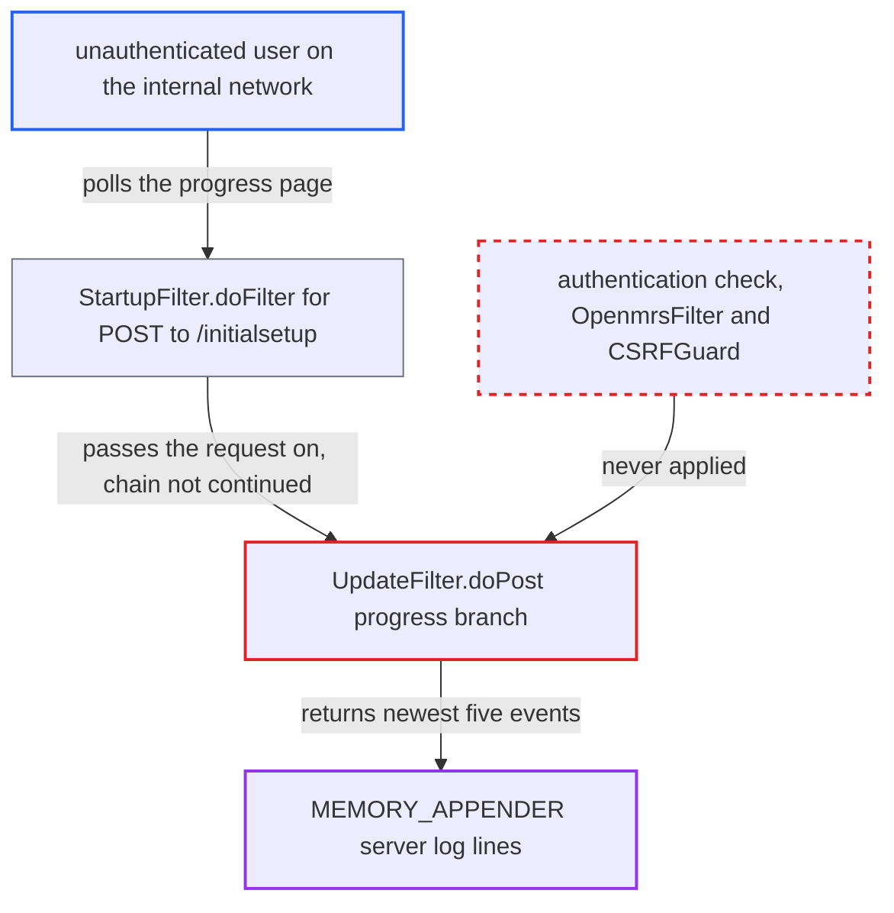

# Update wizard progress endpoint stays unauthenticated after startup and leaks server log lines

| Field | Value |
|---|---|
| ID | `find_01XrpMHYy4iCEo7wZFWANhB9` |
| Severity | **Low** |
| Status | open |
| CWE | CWE-497 — Information exposure |
| Created | 2026-10-21T22:56:48.623459Z |
| Claude Security | https://claude.ai/security/findings/find_01XrpMHYy4iCEo7wZFWANhB9 |

## Description

An unauthenticated user on the internal network can read a live tail of the OpenMRS server log. Each poll returns the newest five log events. This works only on an instance that was upgraded through the update wizard since its last restart. `UpdateFilter.skipFilter` keeps the wizard's progress handler reachable after the upgrade, and that handler checks no credential.

1. **the update wizard** starts an upgrade and stores the job in `updateJob`. `updateJob` is assigned once when the upgrade starts and is never cleared, so it stays non-null until the process restarts. ([`web/src/main/java/org/openmrs/web/filter/update/UpdateFilter.java:222-226`](https://github.com/cx-benchmark/openmrs-core/blob/e6a1b3374ef040e8821dbe4bacc1bdcb50fa4d29/web/src/main/java/org/openmrs/web/filter/update/UpdateFilter.java#L222-L226))
2. **the completion thread** starts OpenMRS in the same JVM. The filter instance keeps the finished job, so OpenMRS serves normally while the progress handler is still live.
3. **the method `UpdateFilter.skipFilter`** returns false for `page=updateProgress.vm.ajaxRequest`. It does this even when `updatesRequired()` is false, so the filter keeps handling this page after startup. ([`web/src/main/java/org/openmrs/web/filter/update/UpdateFilter.java:539-542`](https://github.com/cx-benchmark/openmrs-core/blob/e6a1b3374ef040e8821dbe4bacc1bdcb50fa4d29/web/src/main/java/org/openmrs/web/filter/update/UpdateFilter.java#L539-L542))
4. **the attacker** POSTs `page=updateProgress.vm.ajaxRequest` to `/openmrs/initialsetup`. `StartupFilter.doFilter` passes the request straight to `doPost` and never continues the chain, so `OpenmrsFilter`, CSRFGuard and the user context do not run. ([`web/src/main/java/org/openmrs/web/filter/StartupFilter.java:108-164`](https://github.com/cx-benchmark/openmrs-core/blob/e6a1b3374ef040e8821dbe4bacc1bdcb50fa4d29/web/src/main/java/org/openmrs/web/filter/StartupFilter.java#L108-L164))
5. **the progress branch of `UpdateFilter.doPost`** answers without checking any credential. Because `updateJob` is not null, it writes `updatesRequired`, `message`, `changesetIds` and `executingChangesetId`, and it ignores `authenticatedSuccessfully`. ([`web/src/main/java/org/openmrs/web/filter/update/UpdateFilter.java:241-279`](https://github.com/cx-benchmark/openmrs-core/blob/e6a1b3374ef040e8821dbe4bacc1bdcb50fa4d29/web/src/main/java/org/openmrs/web/filter/update/UpdateFilter.java#L241-L279))
6. **the method `addLogLinesToResponse`** adds the newest five `MEMORY_APPENDER` events to the response. It reads the formatted events from `OpenmrsLoggingUtil.getMemoryAppender().getLogLines()`. ([`web/src/main/java/org/openmrs/web/filter/StartupFilter.java:328-342`](https://github.com/cx-benchmark/openmrs-core/blob/e6a1b3374ef040e8821dbe4bacc1bdcb50fa4d29/web/src/main/java/org/openmrs/web/filter/StartupFilter.java#L328-L342))
7. **the attacker** keeps polling to follow the log. The buffer holds application-wide WARN/ERROR events with stack traces. It also holds INFO events from `org.openmrs.api` and `liquibase`, including the login string from each failed sign-in logged by `HibernateContextDAO.authenticate`. ([`api/src/main/java/org/openmrs/api/db/hibernate/HibernateContextDAO.java:224`](https://github.com/cx-benchmark/openmrs-core/blob/e6a1b3374ef040e8821dbe4bacc1bdcb50fa4d29/api/src/main/java/org/openmrs/api/db/hibernate/HibernateContextDAO.java#L224))

## Assessment

The attacker needs no login and no victim action. They must reach the OpenMRS server from the internal network. The instance must have been upgraded through the update wizard since its last restart. For WAR deployments the wizard is the default upgrade path, because `auto_update_database` defaults to false. The Docker startup script sets it to true. The attacker repeatedly POSTs `page=updateProgress.vm.ajaxRequest` to `/openmrs/initialsetup`.

Impact: The attacker gets a read-only live tail of the server log. It can show failed-login login strings (valid usernames, and sometimes passwords typed into the username field), exception messages and stack traces, SQL error fragments, internal paths and module details. The response also carries the executed changeset ids and the job message. `updateWarnings` and the absolute `updateLogFile` path appear only once, on the first poll after warnings. The attacker cannot choose what gets logged and sees only five events per poll. Nothing can be changed and availability is not affected.

## Recommendation

`skipFilter` keeps the update wizard's progress handler active after the upgrade has finished and OpenMRS is running. The handler has no authentication check, so the in-memory server log is served to any client until the process restarts.

Fix criteria: Once `updatesRequired()` is false and the completion job has finished, a `page=updateProgress.vm.ajaxRequest` request either goes down the normal authenticated filter chain or gets a response with no job or log data. While the wizard is active, only the session that authenticated as a superuser receives progress and log data. To verify, POST the progress page from a fresh client to a started instance that was upgraded through the wizard. Confirm the response has no `logLines`, `changesetIds`, `updateWarnings` or `updateLogFile`.

## Evidence

**https://github.com/cx-benchmark/openmrs-core**

- [`web/src/main/java/org/openmrs/web/filter/update/UpdateFilter.java:539-542`](https://github.com/cx-benchmark/openmrs-core/blob/e6a1b3374ef040e8821dbe4bacc1bdcb50fa4d29/web/src/main/java/org/openmrs/web/filter/update/UpdateFilter.java#L539-L542)
- [`web/src/main/java/org/openmrs/web/filter/update/UpdateFilter.java:241-279`](https://github.com/cx-benchmark/openmrs-core/blob/e6a1b3374ef040e8821dbe4bacc1bdcb50fa4d29/web/src/main/java/org/openmrs/web/filter/update/UpdateFilter.java#L241-L279)
- [`web/src/main/java/org/openmrs/web/filter/StartupFilter.java:108-164`](https://github.com/cx-benchmark/openmrs-core/blob/e6a1b3374ef040e8821dbe4bacc1bdcb50fa4d29/web/src/main/java/org/openmrs/web/filter/StartupFilter.java#L108-L164)
- [`web/src/main/java/org/openmrs/web/filter/StartupFilter.java:328-342`](https://github.com/cx-benchmark/openmrs-core/blob/e6a1b3374ef040e8821dbe4bacc1bdcb50fa4d29/web/src/main/java/org/openmrs/web/filter/StartupFilter.java#L328-L342)
- [`web/src/main/java/org/openmrs/web/filter/update/UpdateFilter.java:222-226`](https://github.com/cx-benchmark/openmrs-core/blob/e6a1b3374ef040e8821dbe4bacc1bdcb50fa4d29/web/src/main/java/org/openmrs/web/filter/update/UpdateFilter.java#L222-L226)
- [`webapp/src/main/resources/log4j2.xml:36-66`](https://github.com/cx-benchmark/openmrs-core/blob/e6a1b3374ef040e8821dbe4bacc1bdcb50fa4d29/webapp/src/main/resources/log4j2.xml#L36-L66)
- [`api/src/main/java/org/openmrs/api/db/hibernate/HibernateContextDAO.java:224`](https://github.com/cx-benchmark/openmrs-core/blob/e6a1b3374ef040e8821dbe4bacc1bdcb50fa4d29/api/src/main/java/org/openmrs/api/db/hibernate/HibernateContextDAO.java#L224)
- [`api/src/main/java/org/openmrs/util/DatabaseUpdater.java:308-314`](https://github.com/cx-benchmark/openmrs-core/blob/e6a1b3374ef040e8821dbe4bacc1bdcb50fa4d29/api/src/main/java/org/openmrs/util/DatabaseUpdater.java#L308-L314)

