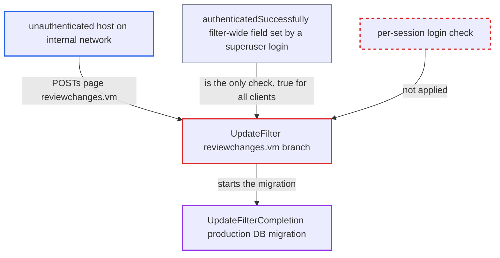

# Update wizard superuser login is stored filter-wide, authorizing every client to run DB upgrade

| Field | Value |
|---|---|
| ID | `find_01GQHSo3vQ4uXCjhbZ9pt1CR` |
| Severity | **Low** |
| Status | open |
| CWE | CWE-488 — Exposure to Wrong Session |
| Created | 2026-10-21T22:55:31.421153Z |
| Claude Security | https://claude.ai/security/findings/find_01GQHSo3vQ4uXCjhbZ9pt1CR |

## Description

An unauthenticated host on the internal network can start the OpenMRS database upgrade without logging in, and can restart it after a failure. This works once any superuser has logged in to the update wizard since the JVM started, while `updatesRequired()` is true. The cause is that `UpdateFilter` keeps the login in the filter-wide field `authenticatedSuccessfully`, not in the HTTP session. A second flaw lets a failed login overwrite the user id recorded on migrated rows.

1. **a superuser** logs in to the update wizard. A successful `authenticateAsSuperUser` sets `authenticatedSuccessfully` to `true`, and no code path ever sets it back to `false`. ([`web/src/main/java/org/openmrs/web/filter/update/UpdateFilter.java:155-161`](https://github.com/cx-benchmark/openmrs-core/blob/e6a1b3374ef040e8821dbe4bacc1bdcb50fa4d29/web/src/main/java/org/openmrs/web/filter/update/UpdateFilter.java#L155-L161))
2. **the filter instance `UpdateFilter`** stores the login in an instance field. The container creates one filter instance, so the field is shared by every request and every session. ([`web/src/main/java/org/openmrs/web/filter/update/UpdateFilter.java:90-94`](https://github.com/cx-benchmark/openmrs-core/blob/e6a1b3374ef040e8821dbe4bacc1bdcb50fa4d29/web/src/main/java/org/openmrs/web/filter/update/UpdateFilter.java#L90-L94))
3. **unauthenticated attacker** POSTs `page=reviewchanges.vm` to `/openmrs/initialsetup`. `UpdateFilter` is mapped on `/*` ahead of `OpenmrsFilter` and `CSRFGuard`, so the request reaches `doPost` with no session user and no token check while `updatesRequired()` is true. ([`web/src/main/java/org/openmrs/web/filter/StartupFilter.java:148-164`](https://github.com/cx-benchmark/openmrs-core/blob/e6a1b3374ef040e8821dbe4bacc1bdcb50fa4d29/web/src/main/java/org/openmrs/web/filter/StartupFilter.java#L148-L164))
4. **the `reviewchanges.vm` branch** checks only `authenticatedSuccessfully` and starts `UpdateFilterCompletion`. The job runs every unrun update changelog against the production database and then calls `startOpenmrs`. Nothing ties the request to the session that logged in. ([`web/src/main/java/org/openmrs/web/filter/update/UpdateFilter.java:213-237`](https://github.com/cx-benchmark/openmrs-core/blob/e6a1b3374ef040e8821dbe4bacc1bdcb50fa4d29/web/src/main/java/org/openmrs/web/filter/update/UpdateFilter.java#L213-L237))
5. **unauthenticated attacker** POSTs `page=reviewchanges.vm` again after a failed run. The `finally` block resets only `isDatabaseUpdateInProgress`, so `authenticatedSuccessfully` stays `true` and the migration can be restarted. ([`web/src/main/java/org/openmrs/web/filter/update/UpdateFilter.java:779-786`](https://github.com/cx-benchmark/openmrs-core/blob/e6a1b3374ef040e8821dbe4bacc1bdcb50fa4d29/web/src/main/java/org/openmrs/web/filter/update/UpdateFilter.java#L779-L786))

## Assessment

The attacker is an unauthenticated host on the internal network. The report's threat model says the server is not reachable from the internet. The server must be in the updates-required state, and a superuser must have logged in to the wizard once since the JVM started. That login can come before the superuser presses Run Updates, or before a run that then failed. The flag stays set until an update finishes successfully. The attacker needs no victim session, so the missing anti-forgery token adds nothing. A second route needs no earlier login. The attacker POSTs `page=maintenance.vm` with any existing username and a wrong password. `authenticateAsSuperUser` then calls `DatabaseUpdater.setAuthenticatedUserId` before `Security.hashMatches` and `isSuperUser` are checked, so the recorded id is overwritten.

Impact: Without credentials, the attacker can launch the production schema and data migration at a time they choose. That could be before the admin's backup or review, or repeatedly after a failure. The migration takes the DB lock and makes irreversible changes. The attacker can also make rows created by the 2.0.x custom changesets carry the wrong creator. The migrations are fixed by the code, so the attacker cannot choose what runs. The report says no PHI is disclosed.

## Recommendation

(1) Wizard login state lives in the filter-wide field `authenticatedSuccessfully`, not in the client's HTTP session. One superuser login authorizes every client, and the state is never cleared.

Fix criteria: The `reviewchanges.vm` step acts only for the HTTP session in which `authenticateAsSuperUser` succeeded, ideally with an unguessable per-session token in the form. A POST of `page=reviewchanges.vm` from a different session after another client's login gets the login page and does not start `UpdateFilterCompletion`. The state is also invalidated when a run finishes or fails.

(2) `authenticateAsSuperUser` calls `DatabaseUpdater.setAuthenticatedUserId` before the password hash and superuser role are verified. A failed login can therefore overwrite the recorded id.

Fix criteria: `authenticatedUserId` is set only after both `Security.hashMatches` and `isSuperUser` return true. A failed login naming a valid username leaves the previously recorded id unchanged.

## Evidence

**https://github.com/cx-benchmark/openmrs-core**

- [`web/src/main/java/org/openmrs/web/filter/update/UpdateFilter.java:213-237`](https://github.com/cx-benchmark/openmrs-core/blob/e6a1b3374ef040e8821dbe4bacc1bdcb50fa4d29/web/src/main/java/org/openmrs/web/filter/update/UpdateFilter.java#L213-L237)
- [`web/src/main/java/org/openmrs/web/filter/update/UpdateFilter.java:90-94`](https://github.com/cx-benchmark/openmrs-core/blob/e6a1b3374ef040e8821dbe4bacc1bdcb50fa4d29/web/src/main/java/org/openmrs/web/filter/update/UpdateFilter.java#L90-L94)
- [`web/src/main/java/org/openmrs/web/filter/update/UpdateFilter.java:155-161`](https://github.com/cx-benchmark/openmrs-core/blob/e6a1b3374ef040e8821dbe4bacc1bdcb50fa4d29/web/src/main/java/org/openmrs/web/filter/update/UpdateFilter.java#L155-L161)
- [`web/src/main/java/org/openmrs/web/filter/update/UpdateFilter.java:779-786`](https://github.com/cx-benchmark/openmrs-core/blob/e6a1b3374ef040e8821dbe4bacc1bdcb50fa4d29/web/src/main/java/org/openmrs/web/filter/update/UpdateFilter.java#L779-L786)
- [`web/src/main/java/org/openmrs/web/filter/update/UpdateFilter.java:330-341`](https://github.com/cx-benchmark/openmrs-core/blob/e6a1b3374ef040e8821dbe4bacc1bdcb50fa4d29/web/src/main/java/org/openmrs/web/filter/update/UpdateFilter.java#L330-L341)
- [`webapp/src/main/webapp/WEB-INF/web.xml:115-122`](https://github.com/cx-benchmark/openmrs-core/blob/e6a1b3374ef040e8821dbe4bacc1bdcb50fa4d29/webapp/src/main/webapp/WEB-INF/web.xml#L115-L122)
- [`web/src/main/java/org/openmrs/web/filter/StartupFilter.java:148-164`](https://github.com/cx-benchmark/openmrs-core/blob/e6a1b3374ef040e8821dbe4bacc1bdcb50fa4d29/web/src/main/java/org/openmrs/web/filter/StartupFilter.java#L148-L164)

